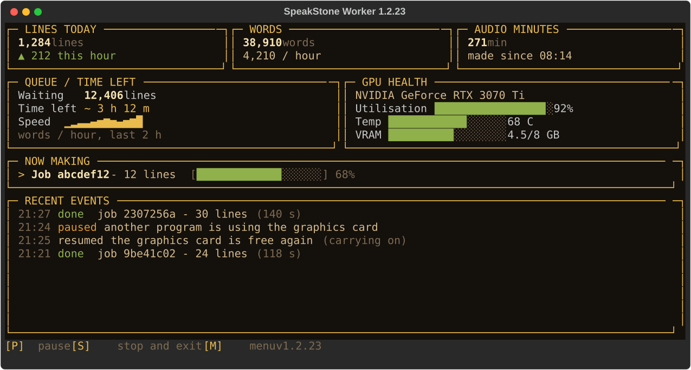
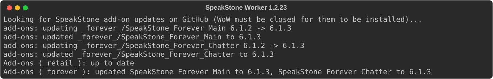
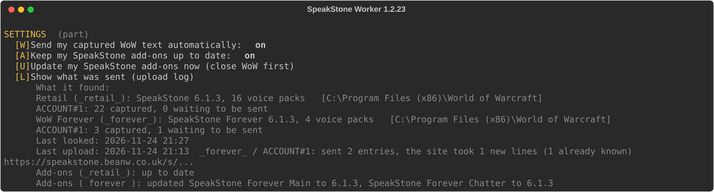
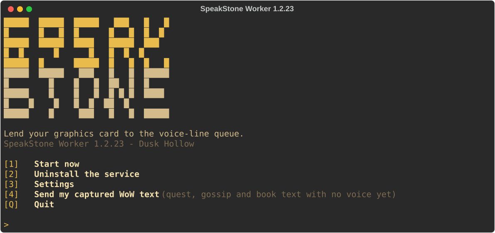

# SpeakStone Worker

**The companion app for [SpeakStone Narration](https://speakstone.beanw.co.uk), the World of Warcraft add-on that
reads quests, books and conversations aloud in voices similar to the in-game characters.**

[](https://github.com/dandwhelan/SpeakStone_Worker/releases/latest)
[](https://github.com/dandwhelan/SpeakStone_Worker/actions/workflows/build.yml)

**[⬇ Download for Windows](https://github.com/dandwhelan/SpeakStone_Worker/releases/latest/download/SpeakStoneWorker-windows.exe)**
· [Linux and all downloads](https://github.com/dandwhelan/SpeakStone_Worker/releases/latest)
· [See the network live](https://speakstone.beanw.co.uk/network)

Unofficial; not affiliated with Blizzard Entertainment. Free, and it always will be.



## What it does

The Worker does three jobs, all on its own once it is set up.

### 1. Keeps your SpeakStone add-ons up to date

It looks at the SpeakStone add-on and voice packs you already have installed, in every WoW game folder it finds
(retail, WoW Forever, ...), and installs new releases for you **while the game is closed**. It only updates what you
already have: it never adds a pack you did not install, never goes back to an older version, and leaves a folder
alone if you have marked it as your own copy.



### 2. Sends the text you read in game

SpeakStone notes the quest text, gossip and book pages it has no voice for yet. Players used to have to type
`/ssharvest export`, copy the window and paste it on the website. The Worker does that for you after you play: it
reads what the add-on saved, sends what is new, and once the website confirms it has it, the add-on clears those
lines at your next login. Every upload is in the Worker's log with a link to its page on the website, so you can see
exactly what went and what became of it.



### 3. Lends your graphics card to the voice-line queue

Every SpeakStone voice line is made on a graphics card. So far that has mostly meant renting them, and that is where
donations went. With the Worker, your PC takes a few lines from the shared queue **while you are not using it**,
makes them, and sends them back. That queue never really empties: new quests arrive with every patch, players report
lines that need fixing, and whenever a better voice engine comes along, the whole library can be made again to sound
closer to the game. Every helper makes that happen sooner.

**This is the biggest help you can give the project, more than a donation.**



## Getting started

1. [Download the Worker](https://github.com/dandwhelan/SpeakStone_Worker/releases/latest/download/SpeakStoneWorker-windows.exe)
   and run it. There is nothing to install by hand.
2. The first start asks which of the three jobs you want (add-on updates, sending WoW text, lending your graphics
   card). Lending the card is only offered with an NVIDIA card of 8 GB or more; on a 16 GB card it suggests running
   two workers, which share one name on the network page. Then it sets up what you chose by itself: it downloads the voice engine and its files (about 20 GB of disk
   in all) and joins the queue. No account and no sign-up.
3. That's it. It runs quietly in the background from then on, and the window shows what it is doing whenever you
   open it.

**You need:** Windows 10/11 or Linux, an NVIDIA graphics card with at least 8 GB of memory, and about 20 GB free on
disk. The add-on updates and the text sending work on any PC that has WoW installed.

Windows may show a "Windows protected your PC" notice the first time, because the app is not code-signed yet. See
[Is it safe?](#is-it-safe) for how to check the download is the real one before you run it.

## When it runs

The Worker is built to never get in your way.

- It starts only after the PC has been idle for a while (10 minutes by default).
- It steps aside the moment you are back, when a game or video is full screen, or when another program needs the
  graphics card's memory, and picks up again later. A job in progress is handed back to the queue, not lost.
- It never runs on battery.
- You can set a daily pause window (for example evenings), pause it from the tray icon or the window, and turn the
  add-on updates or the text sending off in Settings.

| Setting | What it does | Default |
|---|---|---|
| `[1]` Idle minutes | How long the PC must be idle before it starts | 10 |
| `[2]` Daily pause | A time window when it never works | none |
| `[G]` Lend my graphics card | Job 3 (NVIDIA only) | on |
| `[W]` Send my captured WoW text | Job 2 | on |
| `[A]` Keep my add-ons up to date | Job 1 | on |
| `[7]` Update automatically | Keeps the Worker itself up to date | on |
| `[L]` Upload log | Everything it has sent, with links | |
| `[6]` Remove from this PC | Stops it and deletes everything it downloaded | |

## Is it safe?

That's the right question to ask before running any program. Here is what the Worker does and doesn't do, and how
you can check for yourself.

**You can see every line of it.** The full source is in this repository. Each release is built from that source by
GitHub's own build machines ([build logs](https://github.com/dandwhelan/SpeakStone_Worker/actions/workflows/build.yml)),
not on someone's PC, and every download has a fingerprint file next to it (`.sha256`). To check yours, run this in
PowerShell and compare the result with the `.sha256` file on the release page:

```powershell
Get-FileHash .\SpeakStoneWorker-windows.exe -Algorithm SHA256
```

**What it reads on your PC**
- Only SpeakStone's own saved file in your WoW folder, and only the text the add-on noted for the website. It never
  runs anything it reads.
- The versions of the SpeakStone add-ons installed, to know what to update.
- How busy your graphics card is, so it can step aside.

**What it sends**
- The quest, gossip and book text the add-on noted, to the SpeakStone website. With it go the game's language and
  version, the add-on version, and the class, race, sex and faction of the character that read it (never a
  character or account name).
- The voice lines it made, and basic facts about the PC so the queue can hand out the right work: the PC's name,
  the graphics card's name and memory, and the Worker's version. Helpers appear on the
  [network page](https://speakstone.beanw.co.uk/network) under a made-up label you can rename.

**What it never does**
- It never edits WoW's own files or your saved games. It writes only to SpeakStone's add-on folders, its own
  folder, and a temporary folder it uses while installing an add-on update.
- It never asks for your Battle.net login, a password or any payment.
- Apart from its own first-time setup (the voice engine and its files, all kept inside its own folder), it installs
  nothing but updates to the SpeakStone add-ons you already have and to itself. Every update of itself is checked
  against its published fingerprint, and every add-on update against the release's own size and checksums, before
  anything is replaced. A failed or mismatched download is thrown
  away and the current version kept.
- It only talks to the SpeakStone website and GitHub, over encrypted connections, and refuses to be redirected
  anywhere else.

**Proof that it does what it says**
- The [network page](https://speakstone.beanw.co.uk/network) shows live how many lines the helpers are making.
- The upload log (`[L]` in Settings) links each upload to its page on the website, showing which lines arrived and
  which have been voiced since.
- More than 550 automated tests check the Worker's behaviour on every change, including the safety rules above.

**Getting rid of it** takes one key: Settings `[6]` stops it, removes the background task and deletes every file it
downloaded.

## How it works behind the scenes

```
 You play WoW ──► SpeakStone notes lines with no voice yet
                          │
                          ▼
               SpeakStone Worker sends them ──► SpeakStone website ──► the voice-line queue
                                                                             │
       helpers' PCs (and the project's own) take lines from the queue ◄──────┘
                          │
                          ▼
               finished lines go back to the website, are checked,
               and ship in the next voice-pack release ──► the Worker updates your add-ons
```

- **The website** keeps the queue: lines waiting for a voice, lines to remake, and who is working on what. Each line
  is cast to a voice for its character first, so the same character always sounds the same, whichever PC makes it.
- **A Worker** asks for a small batch, makes it on the graphics card and uploads the result. If it stops part-way
  (you came back, the PC went to sleep), the batch simply goes back to the queue for someone else.
- **Every finished line is checked** before it ships, and the voice packs are released through CurseForge, Wago and
  GitHub as usual. The Worker's add-on updates come from those same public releases.

## Questions

**Will it slow my games down?** No: it only works while the PC is idle, and steps aside as soon as you are back or
anything goes full screen.

**Does it cost anything?** No. The only cost is electricity while your PC would otherwise be idle.

**Something looks wrong?** Open an issue on the
[SpeakStone add-on's page](https://github.com/dandwhelan/SpeakStone_Main/issues).

---

## For developers

Everything below is for running the worker engine by hand (owner's machines, rented GPUs). Players do not need any
of it: the app above sets all of this up by itself.

All rights reserved until a licence is chosen.

### Requirements

- Python 3.10 or newer (`net_worker.py` uses only the standard library).
- An NVIDIA GPU with about 6 GB of VRAM free.
- IndexTTS-2 weights in a plain folder, and the Python environment IndexTTS-2 runs in
  (`indextts2_worker.py` needs torch, numpy, soundfile and the `indextts` package). Run the worker with that
  environment's Python, or set `INDEXTTS2_PYTHON` to it.
- ffmpeg on your PATH.
- A worker key (the app gets one by itself when it is set up).

### Setup

```
python net_worker.py init --model-dir D:\models\IndexTTS-2
```

`init` asks for your worker key (typing is hidden) and saves the settings in a per-user config file with
user-only permissions. Optional: `--machine-name`, `--work-dir`, `--api-base`.

Settings can also come from environment variables, which override the file: `SSW_WORKER_KEY`, `SSW_API_BASE`,
`SSW_WORK_DIR`, `SSW_MACHINE_NAME`, `INDEXTTS2_DIR`, `INDEXTTS2_PYTHON`, `SSW_NEED_FREE_MIB`, `SSW_YIELD_LOCK`.

### Sharing the GPU with another program

If something else on your PC uses the GPU and marks it with a lock file, point the worker at it with `"yield_lock"`
in the config file (or `SSW_YIELD_LOCK`). While that lock is held by a running program the worker takes no jobs, and
if it appears mid-job the worker stops, gives the job back and waits.

### Run

```
python net_worker.py run
```

The worker waits until enough GPU memory is free, claims a job, makes the clips, uploads them and repeats.

### Stop

Press Ctrl+C, or create a file named `STOP` in the work folder. The worker finishes cleanly and exits.

### Rented cloud GPUs (container)

For a rented Linux machine with an NVIDIA card, use the container in `docker/`. Everything is put in the image
when it is built, so a new machine pulls the image and starts work: no setup, nothing downloaded at start.

```
docker build -f docker/Dockerfile -t speakstone-worker .
docker run --gpus all -e SSW_WORKER_KEY=sswk_... speakstone-worker
```

- `--build-arg BAKE_MODELS=0` builds a slim image without the model files (about 8 GB smaller). It fetches them
  once into `/data` (or `/workspace/speakstone`); mount a disk that outlives the machine there and later machines
  start without downloading.
- Optional settings: `SSW_MACHINE_NAME`, `SSW_DATA` (where work files and fetched model files go).
- Stopping the container gives the current job back to the queue.

### Model hash

```
python net_worker.py --print-model-hash
```

Prints the fingerprint of your IndexTTS-2 folder. The site only gives jobs to workers whose model matches the
one it expects.

### What the engine sends and receives

- Receives: a job (lines of text, small voice sample clips, settings) from the site.
- Sends: the finished audio clips, a result list, and basic machine facts (machine name, GPU name and free memory,
  worker version).
- Privacy: the worker key is never logged or printed (only `sswk_` plus the last four characters). The text of a
  line is never logged. Nothing else on your machine is read or uploaded.

Exit codes: 0 stopped, 2 config error, 3 key refused, 4 protocol refused, 5 model folder missing, 6 another worker is
already running with this key (config file) on this PC.

The app's own source is in `cli/` (see `cli/README.md`); the screenshots in `docs/images/` are drawn by the app's
own screen code with sample data.
